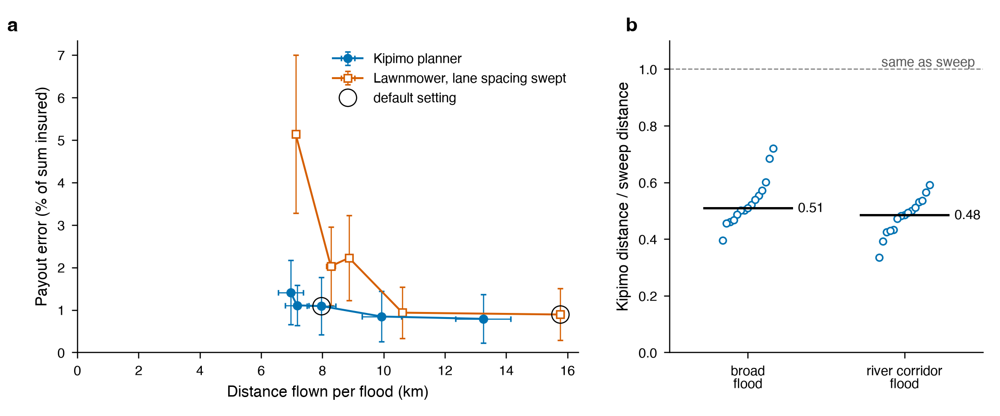

# Kipimo in detail

The [README](../README.md) is the short version. This is everything else.

## The AI agents, up close

| AI agent | Wakes up when | What it can do | What it can never do |
|---|---|---|---|
| Field agent | the mission starts, a farmer's message disagrees with the drone, or the adjuster agent questions a claim | look at the fields and the weather, send the drone to survey, change height and speed, wait, ask for a payout, keep notes | fly the drone itself, work out money, fly in wind above the limit |
| Farmer agent | each message arrives, and when the mission ends | check a field's status, record what the farmer said, text the farmer | change a payment, or mention an amount the rule has not paid |
| Adjuster agent | a claim is ready to pay | read the evidence, approve, or question it | question a claim without a written rule to point to; after three rounds a person decides |
| Dispatcher agent | several villages flood at once | see every village and hub, plan which drone goes where | send a drone further than one battery can reach |

The AI agents remember things between floods. If a farmer often exaggerates, their messages stop sending the drone back. The drone hubs are placed the way cities place ambulance stations: so that as many insured farms as possible are within one flight.

## What the AI does, and what it can't

| Job | Who does it | Why a fixed rule isn't enough |
|---|---|---|
| Flying: where to look, when to wait, what to do if the camera blurs | Field agent | Things change mid flight: the wind picks up, the camera gets dirty, a claim is turned down |
| Talking to farmers | Farmer agent | Real messages mix languages and slang. Simple word matching understands how bad the damage is only 44% of the time |
| Checking claims | Adjuster agent | Deciding whether evidence is good enough takes judgement |
| Money | A fixed rule, never AI | So no AI and no clever message can change a payment |

We checked that the money really is out of the AI's reach. We gave the system a perfect reader that understands every farmer's message exactly as meant. It understood the damage every time instead of 44% of the time, yet payments stayed the same: about 0.9% payout error either way, and about one owed farmer missed in every three floods either way ([report](../evals/reports/oracle-default-test.md)). That is on purpose. A message can send the drone back for another look, but it can never change what anyone is paid.

So we score the AI on the jobs it actually does, against the simple rules it replaces (60 test floods):

| | Simple rules | Gemini |
|---|---|---|
| Understood how bad the damage was | 44% | not run yet |
| Understood which part of the field flooded | 47% | not run yet |
| Understood when it flooded | 65% | not run yet |
| Caught trick messages | 100% | not run yet |
| Replied in the farmer's language | 100% | not run yet |
| Got a turned-down claim paid after looking again | 78% | not run yet |
| Broke a safety rule | 0 times | not run yet |

To fill in the Gemini column, set `GEMINI_API_KEY` and run `make eval AGENTS=live FLOODS=1` (10 floods). Leave out `FLOODS` to run all 60.

## Results

We tested the drone on 30 made-up floods: 15 that spread across the whole farm area, and 15 that follow a river. None of them were used to build or tune the system.



**Figure 1.** **a**, how much the payments were off against how far the drone flew, one point per way of flying. Lower and further left is better. **b**, how far Kipimo flew on each flood, compared with flying over every field in rows. Data: `bench/results.csv`. Vector version: [bench/frontier.pdf](../bench/frontier.pdf).

Kipimo flies about half as far as covering every field, and its payments are off by about 1.1% of the insured amount, against 0.9% for covering everything. None of the 231 farmers who were owed money was missed. Wrong amounts, claims paid at the wrong tier, run at 0.6 per flood, against 0.5 for covering everything. These floods are calm; with storms and camera faults (below) about 1 owed farmer in 3 floods is missed.

## How we test the AI

We grade the AI agents on a fixed set of floods, never on demos (`make eval`).

- **The floods:** 12 test floods, each run five ways: *calm* (simple messages), *messy* (real-world messages: mixed languages, slang, spelling mistakes), *hostile* (farmers who exaggerate, and messages that try to trick the AI), *storm* (too windy to fly at first), and *faults* (the camera blurs and the signal drops). A separate set of floods is the only one we look at while improving the prompts.
- **The grading:** plain code checks the record of every mission against the true damage. No AI marks another AI's work, and any saved mission can be graded again later.
- **What we measure:** how far off the payments are, owed farmers left unpaid, how well each AI agent does its own job, and how often a safety rule is broken. That last number must be zero.
- **How sure we are:** every number comes with a range showing how much it could change by chance.

How the simple rules did, by situation ([full report](../evals/reports/rules-default-test.md)):

| | calm | messy | hostile | storm | faults |
|---|---|---|---|---|---|
| Payments off by, % of insured amount | 0.76 | 0.76 | 0.76 | 1.09 | 1.05 |
| Owed farmers left unpaid, per flood | 0 | 0 | 0 | 0.25 | 1.25 |
| Understood how bad the damage was | 100% | 31% | 26% | 31% | 31% |
| Understood which part of the field flooded | 100% | 33% | 34% | 33% | 33% |
| Caught trick messages | | | 100% | | |
| Broke a safety rule | 0 | 0 | 0 | 0 | 0 |

In storms the drone waits until the wind is safe and never flies above the limit. When the camera blurs, it flies lower and slower to see better. Simple rules understand real-world messages badly: that is the part Gemini has to do better. Farmers missed in storms and camera faults are caused by the weather and the camera, not by reading messages, so better reading will not fix those.

**Memory** ([report](../evals/reports/rules-default-test-memory.md)): when the AI agents remember past floods, they ignore about one message every three floods from farmers who have exaggerated before. Every message that sent the drone back came from a farmer who had misreported, never an honest one.

**Several villages at once** ([report](../evals/reports/district-rules-test.md)): in 12 test districts of 20 villages with 3 hubs each, sending drones to the villages that are owed the most first leaves 7.3% less money waiting than sending each village's nearest drone.

## How the system estimates damage

It starts from a satellite guess of the damage in each field, then corrects that guess with what the drone sees. Two ways of doing this can be switched in `config/default.yaml`:

- **grid**, the default: keeps a separate estimate for every small patch of ground.
- **gp**: also learns from patterns across fields, so looking at a few fields improves the estimate for the rest. Its settings are fitted on separate floods, not picked by hand.

## Research and code this builds on

| Area | Work | Use in Kipimo | Code and data |
|---|---|---|---|
| Natural language to flood data | Groundsource: Gemini turns 5M news reports into 2.6M geo-tagged flood events, [Google Research 2026](https://research.google/blog/introducing-groundsource-turning-news-reports-into-data-with-gemini/) ([paper](https://doi.org/10.31223/X5RR2K)) | The farmer agent does the same at field level; 6,872 real Kenyan events pick our regions and radar weeks | [Zenodo dataset](https://doi.org/10.5281/zenodo.18647053) |
| Flood forecasting | Nearing et al., [Global prediction of extreme floods in ungauged watersheds](https://doi.org/10.1038/s41586-024-07145-1), Nature 627, 2024 (Google Research) | Forecast flood risk before a mission; alerts in Flood Hub format, simulated until the API is connected | [google-research/flood-forecasting](https://github.com/google-research/flood-forecasting), [global_streamflow_model_paper](https://github.com/google-research-datasets/global_streamflow_model_paper) |
| Weather ensembles | Price et al., [Probabilistic weather forecasting with machine learning](https://doi.org/10.1038/s41586-024-08252-9) (GenCast), Nature 2024 (Google DeepMind); the basis of WeatherNext | Flight windows from forecast ensembles | [google-deepmind/weathernext](https://github.com/google-deepmind/weathernext), [WeatherNext data](https://developers.google.com/weathernext) |
| Satellite embeddings | Brown et al., [AlphaEarth Foundations](https://arxiv.org/abs/2507.22291), 2025 (Google DeepMind) | An optional input for the GP belief, not wired in yet | [Earth Engine Satellite Embedding dataset](https://developers.google.com/earth-engine/datasets/catalog/GOOGLE_SATELLITE_EMBEDDING_V1_ANNUAL), [google/earthengine-api](https://github.com/google/earthengine-api) |
| Geospatial agents | [Earth AI](https://research.google/pubs/earth-ai-unlocking-geospatial-insights-with-foundation-models-and-cross-modal-reasoning-2/) and the [Geospatial Reasoning Agent evaluation](https://research.google/pubs/google-earth-ai-geospatial-reasoning-agent-capabilities-and-a-systematic-evaluation/) (Google Research) | Agents that orchestrate geospatial tools; benchmark-style evaluation | |
| Embodied reasoning | Gemini Robotics Team, [Gemini Robotics: Bringing AI into the Physical World](https://arxiv.org/abs/2503.20020), 2025, and [Gemini Robotics 1.5](https://arxiv.org/abs/2510.03342) (Google DeepMind) | Gemini Robotics-ER 2 as the Field agent's model, with Gemini 4 Argon for the Adjuster and Gemini 3.8 Flash for the Farmer agent; the agents sit above deterministic controllers, as here | [google-deepmind/gemini-robotics-sdk](https://github.com/google-deepmind/gemini-robotics-sdk), [googleapis/python-genai](https://github.com/googleapis/python-genai) |
| Weather downscaling | Mardani et al., [Residual corrective diffusion modeling for km-scale atmospheric downscaling](https://doi.org/10.1038/s43247-025-02042-5) (CorrDiff), Commun. Earth Environ. 6, 124, 2025 (NVIDIA) | Optional: sharpen coarse forecasts to field scale | [NVIDIA/earth2studio](https://github.com/NVIDIA/earth2studio), [NVIDIA/physicsnemo](https://github.com/NVIDIA/physicsnemo) |
| On-board inference | NVIDIA TensorRT | Next step: run the int8 camera model on a Jetson. Today it runs with ONNX on a CPU | [NVIDIA/TensorRT](https://github.com/NVIDIA/TensorRT) |
| Where to put drone hubs | Toregas, Swain, ReVelle and Bergman, The location of emergency service facilities, Operations Research 19(5), 1971; Church and ReVelle, [The maximal covering location problem](https://legacy.geog.ucsb.edu/~forest/G294download/MAX_COVER_RLC_CSR.pdf), Papers in Regional Science 32, 1974 | Place hubs like ambulance stations: cover the most insured farms within one flight | |
| Where to look | Krause, Singh and Guestrin, [Near-optimal sensor placements in Gaussian processes](https://jmlr.org/papers/v9/krause08a.html), JMLR 9, 2008 | Greedy information-gain lane choice with a (1 - 1/e) guarantee for mutual information | |
| Index insurance | Carter, de Janvry, Sadoulet and Sarris, [Index Insurance for Developing Country Agriculture: A Reassessment](https://ideas.repec.org/a/anr/reseco/v9y2017p421-438.html), Annu. Rev. Resour. Econ. 9, 2017 | Why measurement is the bottleneck | |
| Index insurance | Clarke, [A Theory of Rational Demand for Index Insurance](https://doi.org/10.1257/mic.20140103), AEJ: Micro 8(1), 2016 | Basis risk lowers demand; Kipimo targets basis risk | |
| Index insurance | Karlan, Osei, Osei-Akoto and Udry, [Agricultural Decisions after Relaxing Credit and Risk Constraints](https://doi.org/10.1093/qje/qju002), QJE 129(2), 2014 | Insured farmers invest more | |
| Index insurance | Janzen and Carter, [After the Drought](https://ideas.repec.org/a/oup/ajagec/v101y2019i3p651-671..html), AJAE 101(3), 2019 | Payouts protect assets and meals after disaster, in Kenya | |

## Commands

Needs [uv](https://docs.astral.sh/uv/). Python 3.11 is installed for you.

```
make demo          # mission control on http://localhost:8000
```

To fly with the AI agents, export `GEMINI_API_KEY`. Without a key, simple rules fly the mission instead, and the screen says so.

| Command | What it does |
|---|---|
| `make demo` | The dashboard: live map, what each AI agent is doing, fields, claims |
| `make run POLICY=infogain` | One mission without the dashboard; prints each field's result |
| `make bench` | The 30 test floods, 450 missions in about 20 seconds; writes `bench/results.csv` and the figure |
| `make test`, `make lint` | 144 tests; code style checks |
| `make eval` | The AI tests; writes `evals/reports/` |
| `make verify` | Checks no record was changed and every payment is signed and correct |
| `make train` | Retrains the drone's camera model (about 10 minutes) |

## Drive it from another AI

The field agent's 11 tools are also available over MCP, a standard way for AI apps to use tools, so another AI can fly a mission:

```
uv run python -m kipimo.agent.mcp_server
```

It gets the same adjuster agent, the same limit on tool calls, and the same payment rule, so it cannot pay anyone the built-in field agent couldn't.

## Layout

```
src/kipimo/
  world/       real (Copernicus) or procedural terrain, farms, river flood, satellite prior, camera, texts
  robot/       multirotor dynamics, rotor power, sensor interface (sim, classical, onnx)
  perception/  classical baseline, tiny UNet training and int8 inference
  belief/      grid and GP beliefs, parcel confidence, GP fitting
  planning/    safety envelope, lawnmower, value of information planner
  payout/      rules, audit policy, signed claims, payout engine
  uplink/      CBOR codec, link model, SQLite outbox, insurer receiver
  agent/       field, farmer and adjuster agents, model adapters, runtime, mission, fallbacks
  evals/       case suite, deterministic graders, runner with bootstrap CIs
  server/      FastAPI + WebSocket dashboard
  bench/       benchmark runner and figure
config/        default.yaml, triggers.yaml, scenarios/, terrain/
models/        camera model, made by make train (not in the repo)
demo/          recordings for replay
```


## Not built

A real drone. Everything flies in a simulation. The code is ready for a camera to plug in, but no hardware has been connected.
